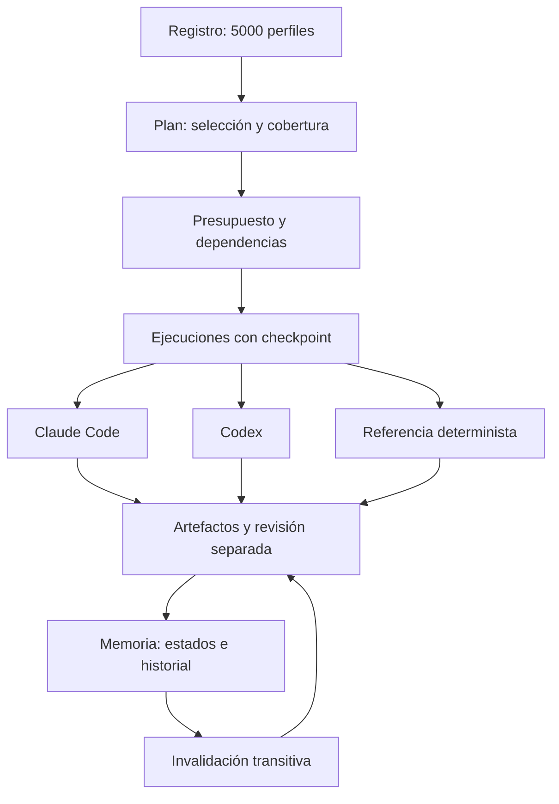

# Arquitectura

El núcleo Python y el registro científico son comunes. Los adaptadores nativos
describen roles para cada entorno; el orquestador usa CLIs reales mediante
subprocesos con contextos nuevos. La demostración usa trabajadores deterministas
identificados como tales.

## Contratos

- `catalogue.py`: generación determinista, esquema, diversidad y validación.
- `planning.py`: selección por etiquetas, grafo acíclico de tareas, equipos3–50.
- `orchestration.py`: concurrencia, llamadas, tiempo, bytes, intentos y recuperación.
- `adapters.py`: comandos CLI sin shell ni elevación de permisos; normalización de respuestas.
- `cross_review.py`: sellado de informes, revisión cruzada y síntesis sin promoción automática.
- `memory.py`: SQLite transaccional, historial por revisión, auditorías y exportación JSON.
- `benchmark.py`: cálculo exacto y reconstrucción separada del ejemplo Hodge.

Las tareas cubren formulación → desarrollo matemático/comprobación física/cálculo →
contraejemplo → auditoría → integración. Un equipo pequeño puede compartir perfiles
entre funciones, pero el auditor recibe un perfil distinto del productor matemático
y su ejecución es separada. La selección refleja coincidencia de campos y métodos,
no una puntuación empírica de inteligencia.

## Presupuesto y recuperación

El límite de llamadas reserva intentos antes de lanzarlos. El tiempo de subprocesos
se acota al menor de plazo individual y tiempo global restante; finalizar/matar
procesos y persistir evidencia puede añadir una pequeña latencia. La salida
capturada combina stdout/stderr y se trunca al máximo configurado, terminando el
grupo de procesos si lo supera. La entrada se comprueba antes de lanzar la CLI.
No se afirma controlar archivos arbitrarios escritos por una CLI ni tokens internos.

Cada intento conserva su espacio. El checkpoint se escribe atómicamente antes de
las operaciones de lanzamiento y registra PID/identidad al confirmar el proceso.
Un lock impide dos coordinadores simultáneos. La recuperación exige plan y
presupuesto idénticos y comprueba hashes de peticiones/resultados terminados.
Un trabajador previo activo o un lanzamiento indeterminado bloquea el reintento;
los intentos interrumpidos consumen presupuesto conservador. No existe garantía
de recuperación automática ante todos los fallos del sistema operativo.
Si el coordinador recibe SIGKILL, su temporizador desaparece y un hijo puede
seguir vivo: la recuperación rechaza duplicarlo. Para imponer tiempo incluso
ante ese fallo abrupto se necesita un supervisor externo del grupo de procesos.

## Memoria científica

Los estados permitidos son los nueve del encargo, con claves estables en
`memory.STATES`. La API rechaza alta directa como demostrado/verificado formalmente.
Para promover exige una derivación pendiente, auditoría confirmada de la revisión
exacta, registros distintos de ejecución completada y archivos/hash conservados.
Una objeción vigente impide promoción. La verificación formal requiere además
herramienta, versión, comando, archivos y log identificados.

Estos controles verifican procedencia y coherencia del registro: no deciden la
verdad de un argumento ni sustituyen Lean u otro verificador. Un operador puede
introducir atestaciones erróneas; la revisión y los artefactos siguen siendo
esenciales. Las dependencias de un ID son inmutables; un grafo diferente requiere
nuevo ID. Esto evita ciclos y conserva la genealogía.

## Grafo opcional

No existía `graphify-out/graph.json` al crear este proyecto. Se puede construir
con `/graphify .` para navegar relaciones de código y documentos; su extracción
semántica consume tokens y requiere autorización antes de ejecutarla.
